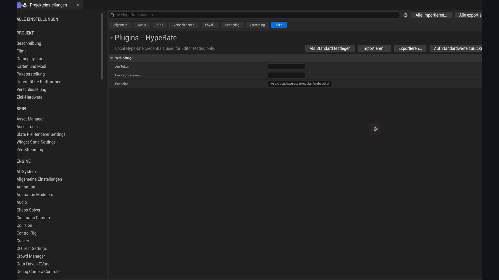
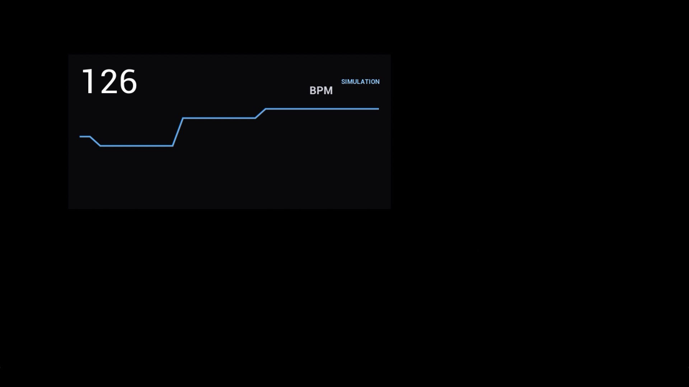

# Getting started

## Requirements

- Verified with Unreal Engine 5.8.4; the source targets Unreal Engine 5.4 or newer
- HypeRate API access and a WebSocket API token
- The Device/Session ID shown by HypeRate

## Install

Place the plugin at `<Project>/Plugins/HypeRate/HypeRate.uplugin`. A source
checkout compiles with the project. A precompiled package must match the exact
Unreal Engine line and target platform it was packaged for.

Restart the Editor and confirm that **Edit > Plugins > Gameplay > HypeRate for
Unreal Engine** is enabled.

## Editor setup

Open **Tools > HypeRate Setup** and enter the API token, Device/Session ID, and
endpoint. These values are stored as per-user Editor settings under the
project's `Saved` configuration, not in the plugin or packaged game.



The token and Device/Session ID are empty by default. The endpoint normally stays
at `wss://app.hyperate.io/socket/websocket`.

Add a `HypeRate Client` component to an Actor. With **Connect On Begin Play**
enabled, the component connects automatically in Play In Editor.

## Blueprint setup

1. Add `HypeRate Client` to an Actor Blueprint.
2. Select the component and add the `On Heart Rate Changed` event.
3. Use the integer event value as BPM.
4. Read `State`, `Current Heart Rate`, or `Last Error` for UI and diagnostics.

The component also provides `On Connected`, `On Disconnected`, `On Error`, and
`On State Changed`. Events are marshalled to Unreal's game thread.

## Packaged games

Editor credentials are deliberately unavailable to packaged builds. Disable
**Connect On Begin Play** when another object supplies configuration, then call:

```cpp
Client->Configure(ApiToken, DeviceId);
Client->Connect();
```

In Blueprint, call the same `Configure` and `Connect` nodes. Obtain the values
from runtime configuration or your own backend. Do not put a long-lived token
in source, a Blueprint default, a map, or a Data Asset.

## Simulation

Add `HypeRate Simulator` beside a client and choose Resting, Workout, Intense,
or Custom. Simulated data travels through `On Heart Rate Changed` and uses the
`Simulating` connection state.

The simulator is useful for UI and gameplay development without a wearable or
network connection. Remove or disable **Play On Begin Play** for production.

## Runtime widget

Create a `HypeRate Heart Rate Widget`, call `Set Client`, and add it to the
viewport. The native widget needs no binary content asset and includes a BPM
history graph. State colors are:

| Color | State |
| --- | --- |
| Green | Live connection |
| Yellow | Connecting, reconnecting, or disconnecting |
| Blue | Simulation |
| Red | Offline or error |



This image shows the native widget in the `Simulating` state. The same widget
turns green after a live HypeRate connection is established.

## Test the complete setup

The [Testing in Unreal Engine](testing-in-unreal.md) guide walks through a safe
simulation-first Blueprint test, the widget, live HypeRate data, Automation
Tests, and common macOS toolchain issues.

## Connection lifecycle

The client connects to the configured WebSocket endpoint, joins
`hr:<DeviceId>`, sends Phoenix heartbeats, parses `hr_update` and `hr_feed`, and
reconnects using capped exponential backoff. Calling `Disconnect` or ending play
cancels reconnect behavior.

## Troubleshooting

- **Not configured:** save Editor settings, or call `Configure` before `Connect`.
- **Connected but no BPM:** verify the exact HypeRate Session ID and confirm the
  wearable is actively publishing.
- **Build cannot find HypeRate headers:** add `HypeRate` to the consuming
  module's dependencies and regenerate project files.
- **Packaged plugin will not load:** install a build made for that Unreal Engine
  version and platform, or use the source package.

