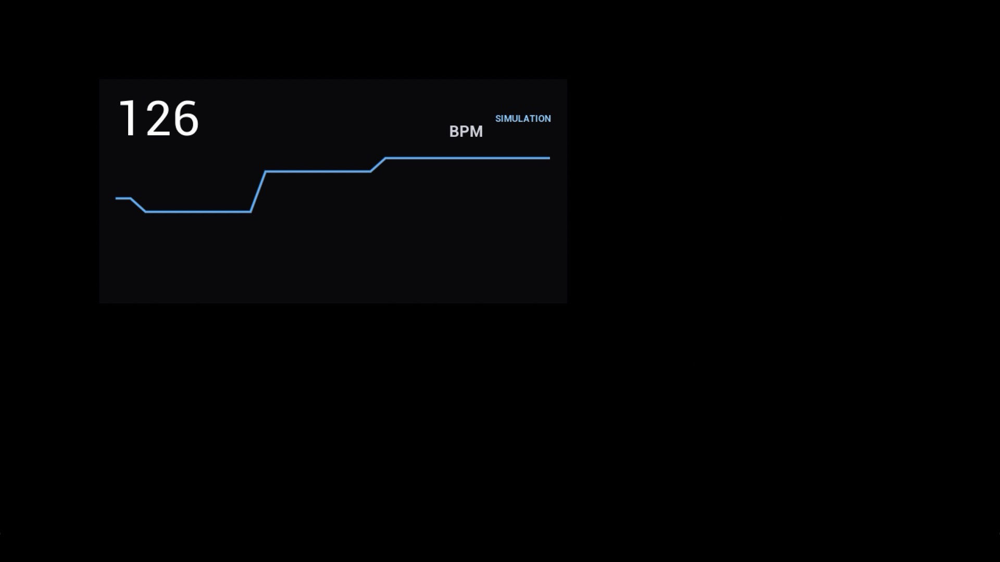
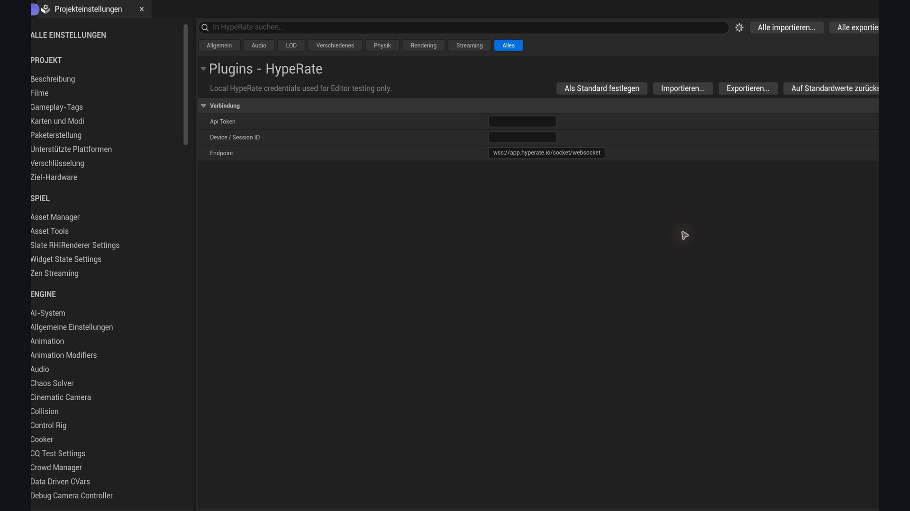

# Testing in Unreal Engine

This guide starts with the built-in simulator, so the first test needs no API
token, wearable, or network connection. It then reuses the same Blueprint for a
live HypeRate test.

## 1. Install and enable the plugin

1. Close Unreal Editor.
2. Place the plugin at `<Project>/Plugins/HypeRate/HypeRate.uplugin`.
3. Open the project and allow Unreal to compile the plugin if prompted.
4. Open **Edit > Plugins**, search for `HypeRate`, and confirm **HypeRate for
   Unreal Engine** is enabled.
5. Restart the Editor if Unreal asks you to do so.

A source checkout builds with the project. A precompiled package must match the
exact Unreal Engine line and platform named in the package.

### macOS: Metal toolchain error

If Unreal reports that the Metal Toolchain is missing, close the Editor and run:

```bash
xcodebuild -downloadComponent MetalToolchain
```

Also make sure Xcode is installed and selected with `xcode-select`. Reopen the
project after the component download finishes.

## 2. Create a simulation test Actor

1. In the Content Drawer, create **Blueprint Class > Actor** and name it
   `BP_HypeRateTest`.
2. Open the Blueprint and add a **HypeRate Client** component.
3. Add a **HypeRate Simulator** component.
4. Select **HypeRate Client** and disable **Connect On Begin Play**. This keeps
   the no-credentials test intentionally offline.
5. Select **HypeRate Simulator** and keep **Play On Begin Play** enabled.
6. Choose the **Workout** preset.
7. Compile, save, and drag `BP_HypeRateTest` into the level.

The simulator automatically finds the client component on the same Actor when
its `Client` field is empty. It publishes through the client's normal
`On Heart Rate Changed` and `On State Changed` events.

## 3. Verify Blueprint heart-rate events

1. In `BP_HypeRateTest`, select **HypeRate Client** in the Components panel.
2. In the Details panel, add the **On Heart Rate Changed** event.
3. Connect its `Heart Rate` integer to a **Print String** node.
4. Compile and press **Play**.

Expected result:

- The viewport prints a changing BPM value.
- The client's `State` is `Simulating`.
- No HypeRate token or wearable is required.

If no value appears, confirm that the Actor is in the active level, **Play On
Begin Play** is enabled on the simulator, and **Connect On Begin Play** is
disabled on the client.

## 4. Add the native HypeRate widget

In the same Blueprint Event Graph:

1. Add **Event BeginPlay**.
2. Add **Create Widget** and select **HypeRate Heart Rate Widget** as the class.
3. From the widget return value, call **Set Client** and pass the Actor's
   **HypeRate Client** component.
4. After `Set Client`, call **Add to Viewport** on the same widget instance.
5. Compile and press **Play** again.



Expected result: the card displays a changing BPM value, a history graph, and a
blue `SIMULATION` badge. Status colors are green for live, yellow for transitional
states, blue for simulation, and red for offline or error.

## 5. Switch from simulation to live HypeRate data

1. Stop Play In Editor.
2. Open **Tools > HypeRate Setup**.
3. Enter the HypeRate API token and Device/Session ID. Keep the default endpoint
   unless your HypeRate integration uses another one.
4. On **HypeRate Simulator**, disable **Play On Begin Play**.
5. On **HypeRate Client**, enable **Connect On Begin Play**.
6. Start the wearable or HypeRate session and press **Play**.



Expected result: the state progresses through `Connecting` to `Connected`, the
widget badge turns green, and BPM values arrive from the live session. If it
connects but no BPM appears, verify the exact Device/Session ID and confirm the
wearable is actively publishing.

Editor credentials are stored below the project's `Saved` configuration and are
not packaged. For a packaged game, call `Configure` at runtime before `Connect`;
do not store a long-lived token in a Blueprint default, map, source file, or Data
Asset.

## 6. Run the plugin Automation Tests

### In the Editor

1. Open **Tools > Test Automation**.
2. Search for `HypeRate`.
3. Select the HypeRate tests and choose **Start Tests**.

The current test suite covers protocol parsing, simulation behavior, and widget
heart-rate input.

### From Terminal on this Mac

Replace the project path below with a C++-capable test project that has the
plugin installed:

```bash
/Volumes/Extern/UE_5.8/Engine/Binaries/Mac/UnrealEditor-Cmd \
  /absolute/path/to/YourProject.uproject \
  -unattended -nop4 -NullRHI \
  -ExecCmds="Automation RunTests HypeRate; Quit" \
  -TestExit="Automation Test Queue Empty"
```

A successful run reports all `HypeRate.*` tests as passed and exits without an
Automation Test failure.

## 7. Final release checks

Before shipping or submitting to Fab, verify all of the following:

- Simulation and live events both reach the same gameplay logic.
- Connect, disconnect, reconnect, and error states display correctly.
- The widget works in Play In Editor and in a packaged Development build.
- A Shipping build succeeds for every advertised platform.
- The packaged plugin contains no API token, Device/Session ID, or local config.
- Precompiled packages clearly name their Unreal Engine version and platform.

Heart-rate data is sensitive biometric information. Obtain consent, minimize
collection and retention, and do not present the integration as medical advice.
