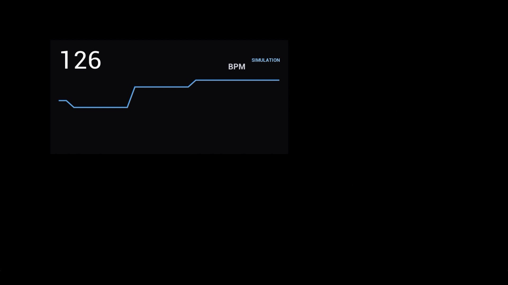
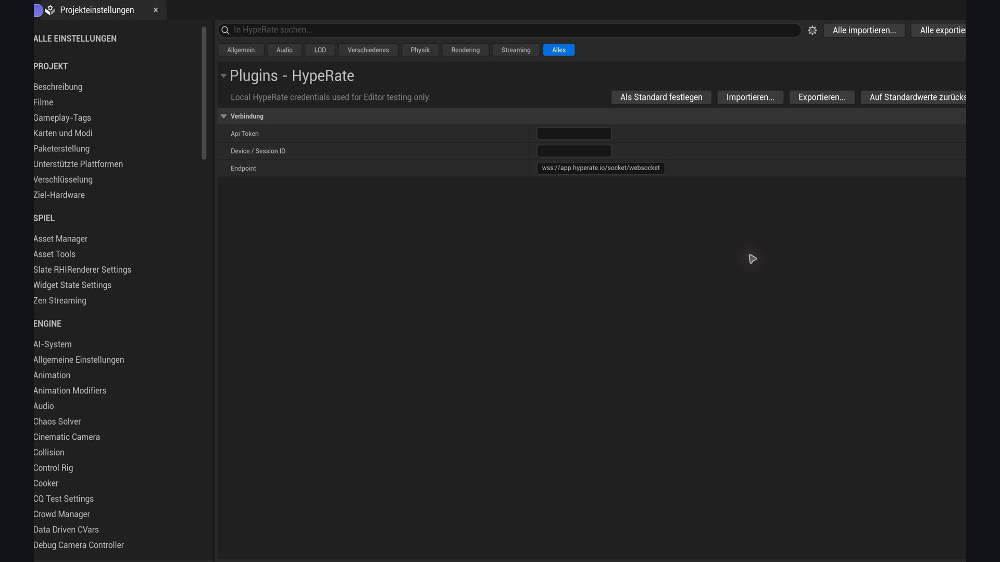

# HypeRate for Unreal Engine


Bring real-time heart rate into Unreal Engine without writing WebSocket, Phoenix
channel, heartbeat, threading, or reconnect code. Use live BPM from Blueprints or
C++ to drive UI, game difficulty, animation, lighting, audio, VFX, or interactive
streaming experiences.



The screenshot above is the native `HypeRate Heart Rate Widget` running in Unreal
Engine 5.8.4. Its blue state badge makes it immediately clear that the displayed
BPM comes from the built-in simulator rather than a live wearable.

> **Preview:** The plugin includes a Blueprint-ready client component, typed
> connection state, automatic reconnect, a no-device simulator, a native runtime
> widget, local Editor setup, automation tests, and GitHub/Fab release tooling.

## Features

- `HypeRate Client` Actor Component for Blueprints and C++
- Game-thread events for heart rate, connection, state, disconnect, and errors
- Automatic Phoenix channel join/leave, 10-second heartbeat, and exponential reconnect
- Local Editor test settings under **Tools > HypeRate Setup**
- Runtime-only credential configuration for packaged games
- Resting, Workout, Intense, and Custom simulation profiles
- Native UMG/Slate BPM widget with connection state and history graph
- Unreal Automation tests for protocol, simulation, and widget behavior
- One source tree for GitHub releases and Fab code-plugin packages

## What can you build?

| Experience | HypeRate signal | Example reaction |
| --- | --- | --- |
| Horror and suspense | Rising BPM | Increase tension, audio, fog, or enemy pressure |
| Fitness and rhythm | Live BPM or zones | Adapt targets, tempo, scoring, and recovery phases |
| Streaming interaction | Heart-rate events | Drive overlays, VFX, avatars, or audience challenges |
| Accessibility research | State and BPM events | Prototype alternative input and feedback systems |
| UI and telemetry | Current BPM and history | Show status, trends, warnings, or session summaries |

## Install from GitHub

Clone a tagged release into your project's `Plugins/HypeRate` directory:

```bash
git clone --branch v1.0.0-pre.1 --depth 1 \
  https://github.com/HypeRate/HypeRate-Unreal-SDK.git \
  YourProject/Plugins/HypeRate
```

Alternatively, download the source zip from a GitHub Release and extract the
`HypeRate` folder below your project's `Plugins` directory. Restart Unreal,
enable **HypeRate for Unreal Engine** if prompted, and build the project.

Precompiled packages from Fab or GitHub must match the Unreal Engine version
and platform for which they were built. Source installations are compiled with
your project.

## Five-minute setup

1. Open **Tools > HypeRate Setup**.
2. Enter your HypeRate API token and Device/Session ID.
3. Add a **HypeRate Client** component to an Actor.
4. Bind **On Heart Rate Changed** in Blueprint.
5. Enter Play In Editor.

Editor test credentials use `EditorPerProjectUserSettings`, stay below the
project's `Saved` directory, and are not packaged. Configure production
credentials at runtime rather than embedding long-lived secrets in an asset.



Only the endpoint has a default value. The token and Device/Session ID fields are
intentionally empty in a fresh project and are stored as local per-user Editor
settings when entered.

## Blueprint workflow

Add `HypeRate Client` to an Actor. In `BeginPlay`, call `Configure` with a token
and Session ID when running outside the Editor, then call `Connect`. Bind the
`On Heart Rate Changed` event; its integer parameter is the latest BPM.

The component exposes `State`, `Current Heart Rate`, `Last Error`, `Is Connected`,
and separate events for connection and state transitions.

## C++ workflow

```cpp
#include "HypeRateClientComponent.h"

HypeRateClient->Configure(ApiToken, DeviceId);
HypeRateClient->OnHeartRateChanged.AddDynamic(this, &AMyActor::HandleHeartRate);
HypeRateClient->Connect();
```

Add `HypeRate` to the consuming module's dependency list:

```csharp
PublicDependencyModuleNames.Add("HypeRate");
```

## Try it without a wearable

Add both `HypeRate Client` and `HypeRate Simulator` to one Actor. The simulator
publishes through the client's normal state and heart-rate events, so gameplay
code uses the same path for live and simulated BPM.

The `HypeRate Heart Rate Widget` is a native `UUserWidget`. Create it like any
other widget, call `Set Client`, and add it to the viewport. It displays BPM,
history, and red/yellow/green/blue status for offline, connecting, live, and
simulation states.

For a complete first test, including the exact Blueprint nodes and a live-data
check, follow [Testing in Unreal Engine](Docs/testing-in-unreal.md).

## Requirements

- Verified with Unreal Engine 5.8.4; the source targets Unreal Engine 5.4 or newer
- A C++-capable project or a compatible precompiled plugin package
- HypeRate API access and a WebSocket API token
- The Device/Session ID shown by HypeRate

API availability and commercial terms depend on the project. See the
[HypeRate API page](https://hyperate.io/api) for current details.

## Documentation

- [Getting started](Docs/getting-started.md)
- [Testing in Unreal Engine](Docs/testing-in-unreal.md)
- [Blueprint and C++ API](Docs/api.md)
- [Fab listing draft](Docs/fab-listing.md)
- [Release process](RELEASING.md)
- [Changelog](CHANGELOG.md)

## Privacy and safety

Heart-rate data is sensitive biometric information. Ask for informed consent,
collect only what the experience needs, and do not present gameplay behavior as
medical advice or diagnosis. Any credential delivered to a client build can
ultimately be extracted and should be scoped accordingly.

